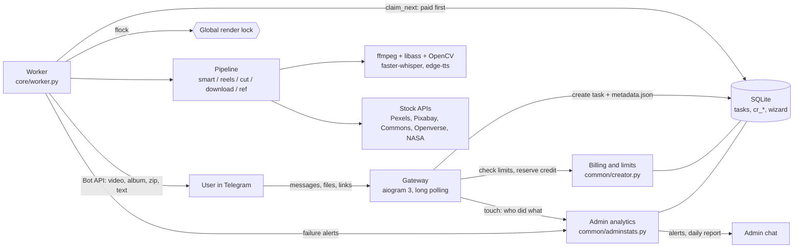

# Architecture

## Overview



Two long-running processes per instance: a **gateway** (UI only, never renders) and a **worker** (renders one task at a time).
They communicate only through SQLite and files in `tasks/task_N/`, so either can be restarted without losing work.

## Two instances, one code base

| | Owner bot | Commercial bot |
|---|---|---|
| Entry | `gateway/bot.py` | `gateway/creator_bot.py` |
| Flag | default | `CREATOR_MODE=1` |
| Users | allow-list (`ALLOWED_USER_IDS`) | anyone, with quotas |
| Output | Google Drive (rclone) | straight to the Telegram chat |
| Data dir / DB | `FACTORY_ROOT` | its own `FACTORY_ROOT` (separate SQLite) |
| Process sandbox | none | systemd hardening, no access to the owner's secrets |

Both workers take the same lock file (`RENDER_LOCK`), so the box is never asked to render two videos at once.

## Task lifecycle

```
draft ──mark_ready──► new ──claim──► processing ──► uploading ──► done
                       ▲                │ error, attempts < MAX_ATTEMPTS
                       └────────────────┘
                                        │ final error / timeout / FetchError
                                        ▼
                                      failed ──► refund + message to the user
```

- A task becomes visible to the worker only after `mark_ready`, when all its files are on disk.
- `claim_next` orders paid users before free ones; position shown to the user is computed with the same rule.
- Errors from unreachable links (`FetchError`) and timeouts are final; other errors get one retry.
- `TaskTimeout` derives from `BaseException` and is armed with `setitimer`, so a stuck ffmpeg call cannot hang the worker.
- On final failure the worker refunds the credit, sends a per-mode message and removes the task folder.

## Data model (commercial instance)

| Table | Purpose |
|---|---|
| `tasks` | queue: id, input_type, status, attempts, error, timestamps |
| `cr_users` | user, credits, free demo used, banned, last_seen, username, source tag, action counter |
| `cr_ledger` | append-only money/credit log: free, spend, refund, buy, grant, revoke. Unique index on `(kind, ref)` for buy/refund/revoke makes payments and refunds idempotent |
| `cr_tasks` | which user owns which task, paid flag (-1 = refunded), mode |
| `cr_log` | titles of recent videos (30-day retention) |
| `cr_events` | analytics events: visit, start, button, command, text, file, prompt, json_ok/json_err, metrics |
| `cr_kv` | admin notification switches, last report day |
| `wizard`, `user_state`, `presets` | per-user UI state and saved settings |

## Smart montage pipeline

1. **Brief** (4-step blitz: topic, main idea, must-have facts, narrative angle) → prompt built by `core/smart.py`.
2. User runs the prompt in any LLM and sends back JSON (scenes, narration, visual queries, optional map/card/chart fields).
3. **Parse and validate**: schema checks, duplicate-query and cliché detection, hero-image limits, readable error list for the LLM to fix.
4. **Voice-over**: edge-tts with text normalisation for Russian (numbers, abbreviations, units, pronunciation dictionary).
5. **Alignment**: faster-whisper word timestamps matched to the script so every scene starts exactly on its phrase.
6. **Visuals per scene**: stock video (portrait first, landscape fallback) or image sources with licence records; cards, charts, icons,
   historical maps (Cliopatria polygons drawn with OpenCV, camera moves with `zoompan`).
7. **Compose**: ffmpeg filter graph, ASS subtitles (word highlight, accent colour from the brand profile), music ducking, sound effects, watermark for free demo.
8. **Finalize**: output format (9:16, 4:5, 1:1, 16:9), logo, CTA plate; size fitted to Telegram limit; attribution lines added to the description.

## ReelsEditor

Silence and filler detection from word timestamps, false-start and repeated-phrase detection, punch-in zooms on accents,
B-roll from English search queries derived from the Russian speech, subtitles, CTA plate that replaces subtitles in the last seconds.

## Security notes

- URLs: scheme and host validated, private/loopback/link-local/metadata ranges rejected before any download; yt-dlp runs with the generic extractor disabled and a duration filter.
- Uploads are accepted only into a per-user `uploads/` folder; worker refuses paths outside it.
- Telegram updates: private chats only, flood guard (15 actions / 10 s), banned users dropped before routing.
- Payments: `pre_checkout_query` verifies pack and amount; credits are granted on `successful_payment` only, once per charge id.
- Secrets live in `.env*` files (git-ignored, mode 600); the hardened commercial units cannot read the owner's `.env`, rclone config or SSH keys.
- User data: `/delete_me` wipes settings, brand assets, events; payment ledger is kept anonymised for accounting.

## Operations

`creator_setup.py` creates the env file, data folders, hardened units, cron jobs (nightly cleanup, daily SQLite backup with 7 copies) and swap.
`creator_bigfiles.py` starts a local Telegram Bot API server in Docker for 2 GB uploads. `transport/cleanup.py` prunes caches and old tasks.
